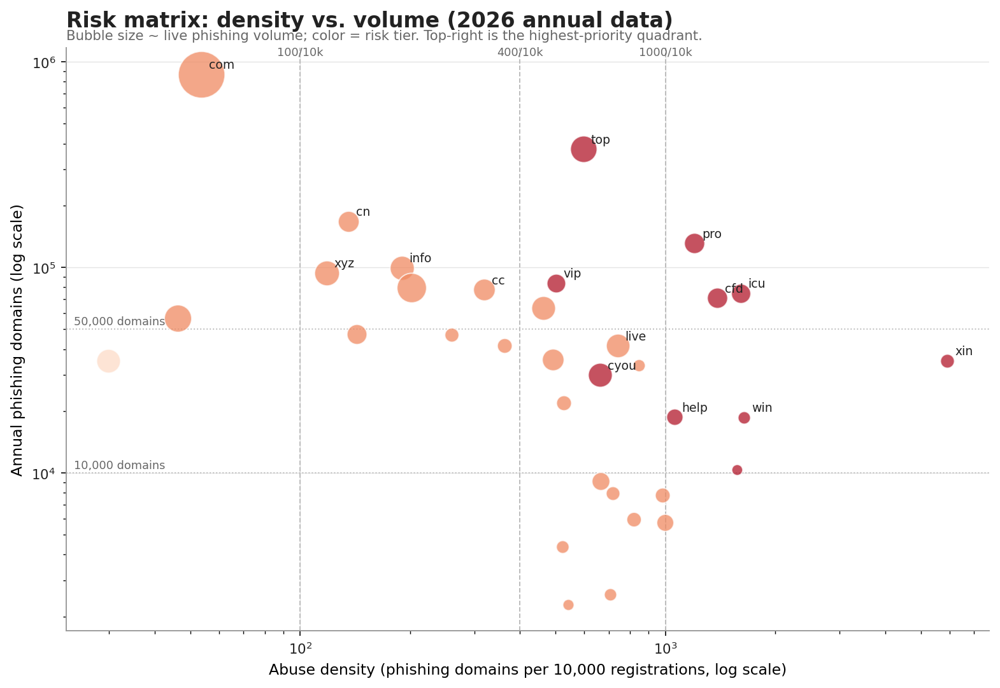

# TLD Abuse Intelligence


**Which top-level domains carry the most phishing, malware-staging, and C2 abuse — and which are actually safe to block?**

TLD Abuse Intelligence is a reproducible, source-attributed ranking of 67 top-level
domains by their concentration of **phishing**, **payload/staging**, and
**command-and-control (C2)** abuse. It combines live feeds, seven years of registry
studies, and Internet Archive history into a four-tier risk model with a separate
evidence-confidence score and a blocklist-suitability rating.



> **Defensive research, not a blocklist.** A high tier means a namespace shows a
> high concentration of abuse. It does not mean every domain under that TLD is
> malicious, and it does not mean blocking the entire TLD is safe. Read
> [`reports/ANALYSIS.md`](reports/ANALYSIS.md) before acting on any tier.

## The short version

- **548,116 live phishing hostnames**, **1,911 payload hosts**, and **219 C2 hosts**
  from live feeds, scored alongside seven years of annual registry data.
- **67 TLDs scored:** 11 Critical, 34 High, 13 Medium, 9 Low.
- **The biggest source is not the densest risk:** `.com` leads absolute volume
  (869,180 annual phishing domains) but sits at 53.7 per 10k and is **not**
  over-represented against popular benign domains.
- **The extreme tail is attacker-registered, not compromised:** `.xin`, `.icu`,
  `.cfd`, `.cyou`, and `.vip` are ~95% maliciously registered.
- **26.0% of live phishing hosts sit on free-hosting/dynamic-DNS platforms**
  (`duckdns.org`, `pages.dev`, `webflow.io`, `vercel.app`, `github.io`), not on
  registrable TLD domains — these must be handled at the platform/account level.

Full analysis, tables, charts, recommendations, and limitations:
[`reports/ANALYSIS.md`](reports/ANALYSIS.md).

## Contents

- [Key findings](#key-findings)
- [Risk tiers at a glance](#risk-tiers-at-a-glance)
- [What to do first](#what-to-do-first)
- [Outputs](#outputs)
- [Quick start](#quick-start)
- [Pipeline](#pipeline)
- [Repository layout](#repository-layout)
- [Data sources](#data-sources)
- [Limitations](#limitations)
- [Citing this work](#citing-this-work)
- [Contributing](#contributing)
- [License](#license)

## Key findings

Snapshot 2026-11-02.

- **67 TLDs scored:** 11 Critical, 34 High, 13 Medium, 9 Low.
  Evidence confidence: 19 High, 41 Medium, 7 Low.
- **Critical TLDs:** `.top`, `.icu`, `.cfd`, `.xin`, `.pro`, `.win`, `.help`,
  `.cyou`, `.vip`, `.garden`, `.lol`. Ten are new gTLDs; `.pro` is a legacy gTLD.
- **`.com` is the largest absolute source** (869,180 annual phishing domains),
  but its density (53.7 per 10k) and live over-representation (0.91) are not
  extreme. It is High risk and **Low** blocklist suitability.
- **`.top` is the most persistent high-scale abuser:** 375,514 annual domains,
  596.1 per 10k, 79.2% maliciously registered, and top-10 by volume or density
  in 6 of 7 years.
- **The extreme tail is attacker-registered, not compromised:** `.xin` (5,910
  per 10k, 95.6% malicious), `.icu` (1,607 per 10k, 95.0%), `.cfd` (1,387 per
  10k, 95.1%), `.cyou` (95.9%), `.vip` (95.1%).
- **26.0% of live phishing hosts (142,520 of 548,116) sit on private platform
  suffixes** such as `duckdns.org` (16,936), `pages.dev` (14,538),
  `webflow.io` (11,940), `vercel.app` (11,566), and `github.io` (7,723). These
  are excluded from parent TLD counts and must be controlled at the
  platform/account level.
- **Feed overlap is low**, so the union is justified: pairwise Jaccard overlap
  ranges from 0.00% to 12.20%.

## Risk tiers at a glance

| Tier | Count | Meaning |
|---|---:|---|
| Critical | 11 | Extreme abuse density and/or near-total attacker registration at material scale |
| High | 34 | Strong density, volume, persistence, or payload/C2 signal |
| Medium | 13 | Meaningful abuse signal, often lower scale or weaker corroboration |
| Low | 9 | Marginal or stale signal; watchlist only |

Tier rules are **density-led and absolute** (not percentile-based) so results
remain comparable across runs. Tier and confidence are independent: a Critical
tier with Low confidence is a watchlist item, not a policy target. See
[`docs/METHODOLOGY.md`](docs/METHODOLOGY.md).

## What to do first

- **High-risk or constrained environments:** evaluate TLD-level blocks for
  `.xin`, `.icu`, `.cfd`, `.cyou`, `.vip`, `.sbs`, `.click`, `.live`, `.win`,
  `.help`, `.garden`, and `.top`. Validate business dependencies first; `.top`
  and `.pro` have moderate collateral.
- **Never blanket-block** `.com`, `.net`, `.org`, `.cn`, `.jp`, `.ru`, `.de`,
  `.uk`, `.br`, `.in`, or `.io`; use domain-level detection and takedown.
- **Control free-hosting subdomains** at the platform namespace level. Parent-TLD
  rules such as "block `.dev`" would be both over-broad and ineffective.
- **Monitor the surge cohort** (`.pro`, `.icu`, `.cfd`, `.cyou`, `.jp`, `.mobi`,
  `.garden`) for campaign reuse, registrar concentration, and new-registration
  patterns.
- **Treat payload/C2 signals as enrichment**, not as standalone TLD evidence.
  The C2 sample is too small for confident TLD-wide conclusions.

## Outputs

| Output | Description |
|---|---|
| [`reports/ANALYSIS.md`](reports/ANALYSIS.md) | Full analytical report with findings, tables, and recommendations |
| [`reports/analysis_data.json`](reports/analysis_data.json) | Machine-readable analysis payload |
| [`data/processed/tld_risk_scores.csv`](data/processed/tld_risk_scores.csv) | Per-TLD scores, tiers, and confidence |
| [`data/processed/tld_risk_scores.json`](data/processed/tld_risk_scores.json) | Same scores as JSON |
| [`reports/figures/`](reports/figures) | 12 report figures |
| [`data/processed/snapshot_manifest.json`](data/processed/snapshot_manifest.json) | SHA-256 provenance for each source snapshot |

## Quick start

Python 3.11+ is recommended.

```bash
python3 -m venv .venv
source .venv/bin/activate
pip install -r requirements.txt

# Full pipeline (downloads current feeds and history)
make all

# Or run stages individually
python3 scripts/collect.py --refresh-psl
python3 scripts/collect_history.py
python3 scripts/analyze.py
python3 scripts/charts.py
python3 scripts/report.py
python3 scripts/validate.py
```

Re-running with cached raw data:

```bash
python3 scripts/collect.py --reuse
python3 scripts/collect_history.py --reuse
```

Useful options:

| Command | Purpose |
|---|---|
| `collect.py --date YYYY-MM-DD` | Label the snapshot date |
| `collect.py --reuse` | Reuse existing raw downloads |
| `collect.py --force` | Re-download everything |
| `collect.py --refresh-psl` | Update the committed Public Suffix List |
| `collect_history.py --only payload` | Rebuild only payload history |
| `collect_history.py --limit 8` | Cap Wayback snapshots per feed |
| `analyze.py --snapshot YYYY-MM-DD` | Analyze a specific raw snapshot |

A scheduled GitHub Actions workflow (`.github/workflows/refresh.yml`) refreshes
the data every Monday at 06:00 UTC and commits the regenerated outputs.

## Pipeline

1. **Collect** — five phishing feeds, URLhaus-derived payload lists, C2Intel
   feeds, Tranco top-1M, and the Public Suffix List.
2. **Normalize** — parse hosts with the PSL, separate ICANN registrable domains
   from PRIVATE platform suffixes (`pages.dev`, `vercel.app`, etc.), and
   deduplicate to eTLD+1.
3. **Reconstruct history** — pull archived URLhaus/C2Intel captures from the
   Wayback Machine and recompute TLD distributions.
4. **Score** — density (35%), volume (15%), persistence (15%), malicious
   registration share (15%), payload (10%), C2 (5%), momentum (5%).
5. **Classify** — absolute density/volume tier rules, evidence modifiers, and
   caps; independent High/Medium/Low confidence.
6. **Assess blocking** — Tranco collateral and platform concentration produce a
   separate blocklist-suitability rating.
7. **Report** — Markdown report and 12 figures, validated for internal
   consistency.

## Repository layout

```
.
├── scripts/
│   ├── common.py            # PSL parsing, host normalization, feed analysis
│   ├── collect.py           # current feeds + Tranco + PSL
│   ├── collect_history.py   # Wayback payload/C2 history
│   ├── analyze.py           # risk scoring, tiers, confidence, aggregates
│   ├── charts.py            # 12 report figures
│   ├── report.py            # reports/ANALYSIS.md
│   └── validate.py          # output and model invariants
├── data/
│   ├── curated/             # annual 2020–2026 phishing TLD data
│   ├── reference/           # Public Suffix List
│   ├── processed/           # committed aggregates and scores
│   └── raw/                 # downloaded feeds (gitignored)
├── reports/
│   ├── ANALYSIS.md          # main analytical report
│   ├── analysis_data.json   # machine-readable analysis payload
│   └── figures/             # PNG charts
├── docs/
│   ├── METHODOLOGY.md
│   └── DATA_SOURCES.md
├── .github/workflows/refresh.yml
├── Makefile
└── requirements.txt
```

## Data sources

Current: OpenPhish, Phishing Army, Phishing.Database, Spam404, malware-filter
(phishing and URLhaus), C2IntelFeeds, Tranco, and the Public Suffix List.
Historical: Interisle *Phishing Landscape* (2020–2023), Cybercrime Information
Center TLD tables (2024–2026), and Internet Archive captures of URLhaus/C2Intel
feeds. Source URLs, cadence, extraction notes, and terms are documented in
[`docs/DATA_SOURCES.md`](docs/DATA_SOURCES.md).

## Limitations

- Annual registry data has reporting lags and varying top-N cutoffs; early years
  are partial.
- Malicious-registration share is imputed at 74% when a TLD is absent from the
  top-20 malicious-registration table. Imputation is flagged and prevents High
  confidence.
- Live feeds over-sample recently reported domains and under-sample stealthy
  infrastructure. Feed overlap is documented in the report.
- C2 samples are small (219 hosts; 125 registrable domains) and should not be
  used alone for TLD policy.
- Platform suffixes are excluded from TLD counts by design; blocking a parent
  TLD such as `.dev` would not remove `pages.dev` abuse.
- TLD-level blocking has high collateral risk; validate business traffic,
  platform concentration, data freshness, and legal constraints first.

## Citing this work

If you use this dataset or analysis, please cite it using
[`CITATION.cff`](CITATION.cff) (GitHub's "Cite this repository" button will
also generate APA/BibTeX). Please link back to
<https://github.com/jejex0/tld-abuse-intel> and note the snapshot date, since
the data is refreshed continuously.

## Contributing

Issues and pull requests are welcome — especially corrections to the curated
annual data, additional public feeds, and improvements to the tier model. See
[`CONTRIBUTING.md`](CONTRIBUTING.md) for guidelines. Please include a source URL
and retrieval date for any data change.

## License

Code: MIT ([`LICENSE`](LICENSE)). Derived data and analysis: CC BY 4.0
([`DATA_LICENSE.md`](DATA_LICENSE.md)). Upstream feeds keep their own terms and
raw data is not redistributed.
