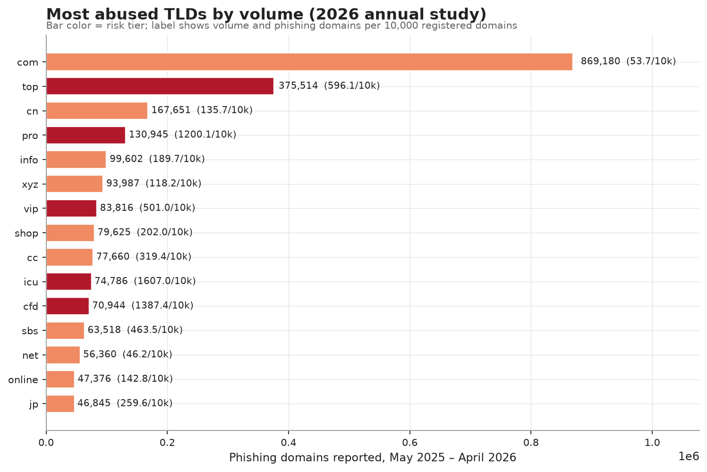
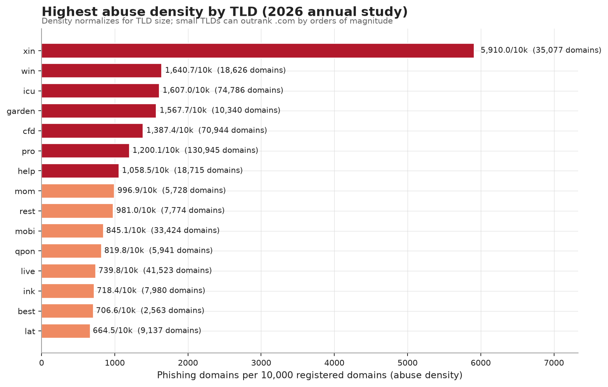
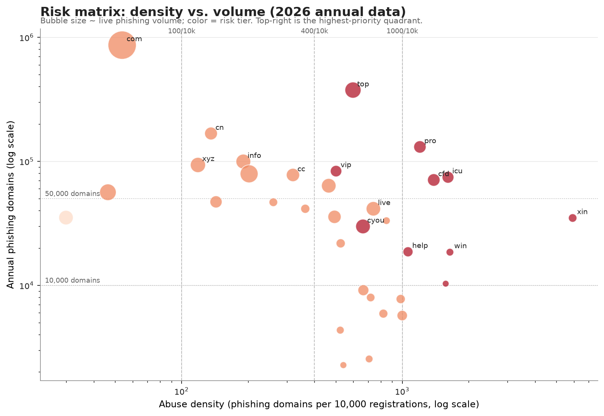
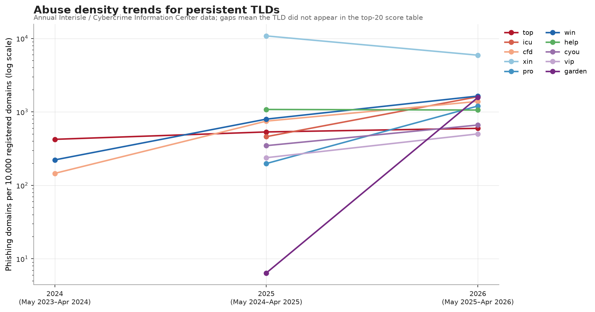
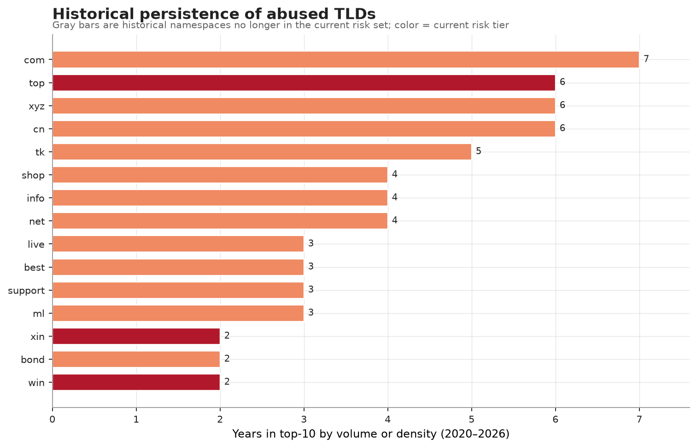
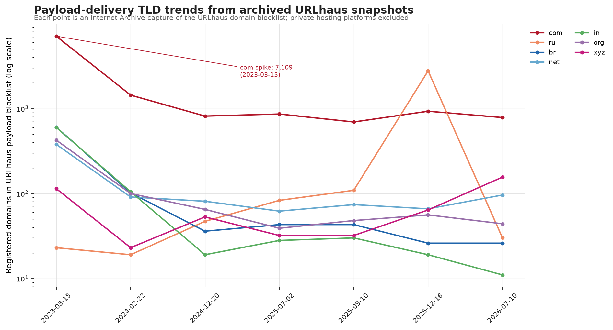
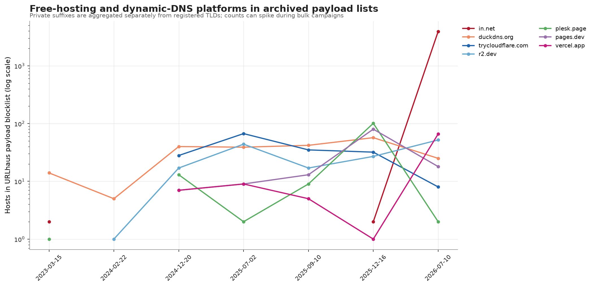
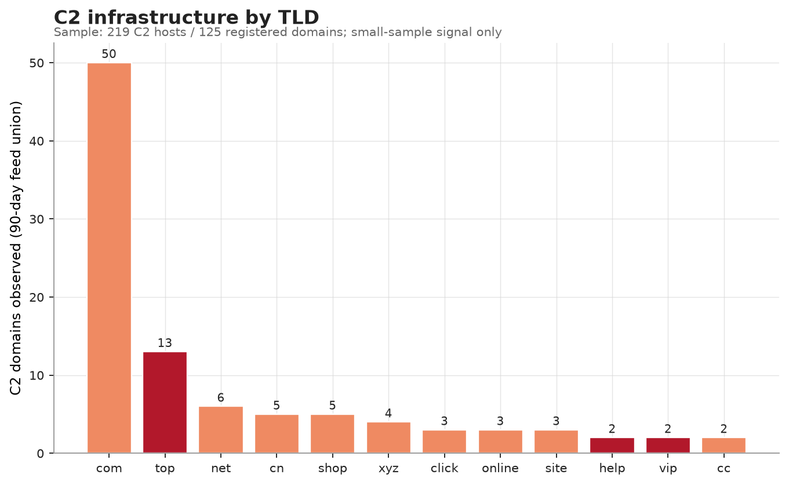
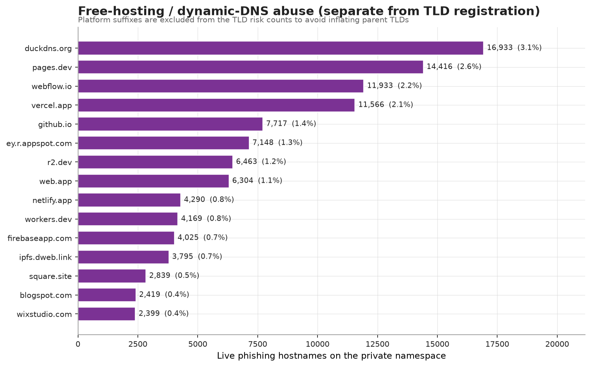
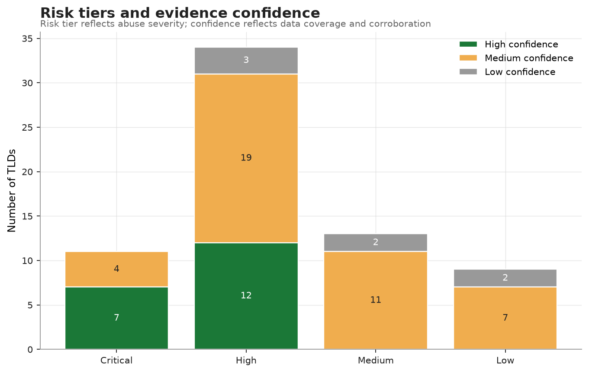

# TLD Abuse Intelligence: Phishing, Payload Delivery, and C2 Infrastructure

**Generated:** 2026-11-02T14:39:17+00:00  
**Current snapshot:** 2026-11-02  
**Annual data window:** 2020–2026 (interrupted/partial for some early years)  
**Payload history:** 11 archived URLhaus snapshots, 2023-03-15 → 2026-07-10  
**C2 history:** 2 archived C2Intel snapshots, 2025-08-15 and 2025-09-20; current 90-day feed

> **Scope and caution.** This is defensive threat-intelligence research, not a universal blocklist.
> A high risk tier means a namespace shows a high concentration of abuse. It does not mean every
> domain in that namespace is malicious, and it does not mean blocking the entire TLD is safe.

---

## Executive summary

We combined **548,116 live phishing hostnames** (280,674 unique registrable domains)
from five independent feeds, **1,911 payload-delivery hosts**, **219 C2 hosts**,
seven years of Interisle / Cybercrime Information Center registry data, and archived payload/C2
snapshots. The result is a reproducible, source-attributed ranking of **67 TLDs** across
four risk tiers.

**Tier distribution:** **11 Critical**, **34 High**,
**13 Medium**, **9 Low**. Evidence confidence is
**19 High**, **41 Medium**, **7 Low**.

### Key findings

1. **The top five risk-ranked namespaces are `.top`, `.icu`, `.cfd`, `.xin`, `.pro`.** These combine extreme abuse density,
   material volume, and/or near-total attacker registration. Ten of the eleven Critical TLDs are
   new gTLDs; the exception is the legacy `.pro` namespace.
2. **`.top` is the single most consistent high-scale abuser.** It ranks #2 by annual phishing
   volume (375,514 domains), #17 by density
   (596.1/10k), and appears in the top-10 by volume or
   density in **6 of 7 years**. Its malicious-registration share is
   79.2%.
3. **`.com` is the largest absolute source of phishing but is not the highest-density risk.**
   It has **869,180** annual phishing domains, yet
   **53.7/10k** density — roughly one order of magnitude below
   `.top` and two orders below `.xin`. In the live feeds, `.com` is **under-represented** relative to
   its Tranco popularity (over-representation index 0.91). It is
   High risk but Low blocklist suitability.
4. **The extreme tail is dominated by attacker-registered domains, not compromised sites.**
   `.icu` (95.0% maliciously registered), `.cfd`
   (95.1%), `.xin` (95.6%),
   `.cyou` (95.9%), and `.vip`
   (95.1%) show very high attacker-registration shares.
   `.pro` (84.5%) and `.top` (79.2%)
   are lower but still high.
5. **`.pro`, `.icu`, `.cfd`, `.cyou`, and `.jp` show sharp year-over-year changes.**
   `.pro` grew 666.7% in annual phishing domains;
   `.icu` 285.7%; `.cfd` 192.7%;
   `.cyou` 312.0%; `.jp`
   8,672.5% (534 → 46,845 domains).
   The `.jp` jump is an outlier that warrants validation rather than immediate blanket action.
6. **Free hosting and dynamic DNS are a TLD-scale problem in their own right.**
   **26.0%** of live phishing hosts (142,520 of 548,116) sit on
   private platform suffixes, not registrable TLD domains. The largest are `duckdns.org` (16,936),
   `pages.dev` (14,538), `webflow.io` (11,940), `vercel.app` (11,566), and `github.io` (7,723).
   These are excluded from TLD risk counts to avoid unfairly inflating `.dev`, `.app`, `.io`, and `.org`.
7. **Payload delivery is concentrated in `.com`, but the high-density tail matters more for blocking.**
   `.com` accounts for **40.1%** of current URLhaus registered payload domains
   (591 of 1,475). The next tier is `.net` (80), `.org` (58),
   `.cc` (32), `.top` (29), `.xyz` (27), `.win` (24), and `.lol` (21). Platform payload hosting is led by
   `r2.dev` (76), `workers.dev` (34), `pages.dev` (23), and `vercel.app` (20).
8. **C2 data is small but useful as a supporting signal.** The current union has 219 hosts
   (204 non-platform hostnames / 125 unique registrable domains), led by `.com` (49), `.top` (13), `.net` (6), `.cn` (5), and `.shop` (5).
   Historical C2 snapshots are too sparse for trend claims. C2 infrastructure frequently uses popular
   TLDs and compromised hosts, so TLD blocking is not a C2 strategy.
9. **Historical persistence separates durable abuse from one-year spikes.** `.com`, `.top`, `.xyz`, and
   `.cn` appear in top-10 lists in 6–7 of 7 years. `.tk` persists in 5 years but is a special case:
   Freenom's registration freeze means today's `.tk`/`.ml`/`.ga`/`.cf`/`.gq` abuse is mostly legacy
   infrastructure. `.icu`, `.pro`, `.win`, and `.help` are surge entrants with sudden 2026 scale.
10. **Feed overlap is low; the union is justified.** Pairwise Jaccard overlap between phishing feeds is
    as low as 0.00% and at most 12.20%. OpenPhish is mostly contained
    in Phishing Army (97.2% containment) but adds freshness; Phishing.Database and Spam404 contribute
    largely disjoint domain sets.

### What to do first

- **For high-risk or constrained environments:** evaluate TLD-level blocks for `.xin`, `.icu`,
  `.cfd`, `.cyou`, `.vip`, `.sbs`, `.click`, `.live`, `.win`, `.help`, `.garden`, and `.top`.
  Validate business dependencies first; `.top` and `.pro` have moderate collateral.
- **Never blanket-block** `.com`, `.net`, `.org`, `.cn`, `.jp`, `.ru`, `.de`, `.uk`, `.br`, `.in`,
  or `.io`; use domain-level detection and takedown.
- **Control free-hosting subdomains** at the platform namespace level. Parent-TLD rules such as
  “block `.dev`” would be both over-broad and ineffective.
- **Monitor the surge cohort** (`.pro`, `.icu`, `.cfd`, `.cyou`, `.jp`, `.mobi`, `.garden`) for
  campaign reuse, registrar concentration, and new-registration patterns.
- **Treat payload/C2 signals as enrichment**, not as standalone TLD evidence. The C2 sample is
  too small for confident TLD-wide conclusions.

---

## 1. Data collection and scope

### 1.1 Current live feeds

| Source | Kind | Unique hosts | Non-platform hosts | Platform hosts | TLDs observed |
|---|---|---:|---:|---:|---:|
| `openphish` | phishing | 245 | 113 | 132 | 41 |
| `phishing_army` | phishing | 151,709 | 135,214 | 16,495 | 344 |
| `phishing_database` | phishing | 386,094 | 259,520 | 126,574 | 553 |
| `spam404` | phishing | 8,140 | 8,115 | 25 | 115 |
| `phishing_filter` | phishing | 22,955 | 13,459 | 9,496 | 258 |
| `urlhaus_filter` | payload | 1,911 | 1,667 | 244 | 165 |
| `c2intel_30d` | c2 | 86 | 84 | 2 | 22 |
| `c2intel_90d` | c2 | 204 | 189 | 15 | 36 |
| `c2intel_dns` | c2 | 15 | 15 | 0 | 8 |

The live union contains **548,116 phishing hostnames** and **280,674 unique
registrable phishing domains**. The difference is subdomain reuse: many hostnames collapse to the
same registrable domain. Of the live phishing hosts, **405,596** are non-platform
hostnames and **142,520** are platform hosts. Payload and C2 feeds are analyzed separately.

**Feed design choices:**

- **Phishing feeds:** OpenPhish (freshness), Phishing Army, Phishing.Database, Spam404, and the
  malware-filter phishing mirror. The union is de-duplicated at the registrable-domain level.
- **Payload feed:** the malware-filter mirror of URLhaus. URLhaus tracks malware distribution URLs;
  some are payload/staging hosts, some are compromised legitimate sites. It is not a pure “staging
  only” feed.
- **C2 feed:** C2IntelFeeds 30-day, 90-day, and DNS C2 domain feeds. The 90-day feed is the largest
  and is used for current counts. The sample is small and is weighted accordingly.
- **Popularity baseline:** Tranco top-1M domains, excluding private platform suffixes, used to
  compute live over-representation.

### 1.2 Historical registry data

The annual data comes from Interisle Consulting Group's Phishing Landscape studies and the
Cybercrime Information Center's TLD tables. Coverage is uneven by design:

| Year | Period | TLDs recorded | Count table | Score table | Malicious-registration table |
|---|---|---:|---:|---:|---:|
| 2020 | May–Jul 2020 (3-month study) | 34 | 20 | 20 | 0 |
| 2021 | May 2020 – Apr 2021 | 20 | 10 | 10 | 0 |
| 2022 | May 2021 – Apr 2022 | 9 | 5 | 0 | 0 |
| 2023 | May 2022 – Apr 2023 | 9 | 5 | 5 | 1 |
| 2024 | May 2023 – Apr 2024 | 31 | 20 | 20 | 20 |
| 2025 | May 2024 – Apr 2025 | 45 | 20 | 20 | 20 |
| 2026 | May 2025 – Apr 2026 | 34 | 20 | 20 | 20 |

- **2020** used a three-month study window (May–July), so its counts are not directly comparable to
  full-year studies.
- **2021–2023** reports list top-5/top-10 tables; full top-20 volume, density, and malicious
  registration tables are available from **2024 onward**.
- **2022** count ranks are available for the top five; exact counts and the full score table were not
  extractable from the published report. The dataset records only what the source supports.
- **2025 baselines** for 2026 entrants were filled from the 2026 year-over-year table. These rows are
  marked in the curated CSV and may not have been in the 2025 top-20 tables.
- **2026** is the current annual dataset: May 2025 – April 2026.

All source URLs, periods, and extraction notes are recorded in
`data/curated/phishing_tld_history.csv`.

### 1.3 What “TLD” means in this report

Three namespace levels are separated deliberately:

1. **Root TLD for registered domains** — the last label of the ICANN public suffix (`.com`, `.top`,
   `.cn`). Multi-label public suffixes are aggregated to their root (`co.uk` → `uk`, `my.id` → `id`).
   This matches the annual registry tables.
2. **Public suffix** — the full ICANN suffix (`co.uk`, `com.br`, `my.id`). A detail table is available
   in `data/processed/live_tld_counts.csv`.
3. **Private platform suffix** — a privately operated namespace such as `pages.dev`, `vercel.app`,
   `github.io`, `duckdns.org`, or `r2.dev`. These are **not** counted as registrations in the parent
   TLD. Hostnames on these namespaces are reported separately because the attacker did not register
   the parent TLD; they abuse a platform.

This distinction changes the story materially. Without it, `.dev` would appear to be one of the most
abused “TLDs” because of `pages.dev` and `r2.dev`; in reality, the abuse is on the platform
namespace, not on registered `.dev` domains.

### 1.4 Feed overlap and complementarity

| Feed A | Feed B | Hosts A | Hosts B | Intersection | Jaccard | Containment |
|---|---|---:|---:|---:|---:|---:|
| phishing_army | phishing_filter | 151,709 | 22,955 | 18,992 | 12.20% | 82.74% |
| phishing_database | phishing_filter | 386,094 | 22,955 | 1,687 | 0.41% | 7.35% |
| openphish | phishing_filter | 245 | 22,955 | 51 | 0.22% | 20.82% |
| phishing_army | phishing_database | 151,709 | 386,094 | 1,194 | 0.22% | 0.79% |
| openphish | phishing_army | 245 | 151,709 | 238 | 0.16% | 97.14% |
| openphish | phishing_database | 245 | 386,094 | 3 | 0.00% | 1.22% |
| openphish | spam404 | 245 | 8,140 | 0 | 0.00% | 0.00% |
| phishing_army | spam404 | 151,709 | 8,140 | 0 | 0.00% | 0.00% |
| phishing_database | spam404 | 386,094 | 8,140 | 7 | 0.00% | 0.09% |
| spam404 | phishing_filter | 8,140 | 22,955 | 0 | 0.00% | 0.00% |

Pairwise Jaccard overlap ranges from 0.00% to 12.20%. OpenPhish is
mostly contained in Phishing Army (97.1%
containment), while Phishing.Database and Spam404 are largely disjoint. Phishing Army and the
malware-filter phishing mirror overlap by 12.20%
(Jaccard), and Phishing.Database adds only 7.3%
containment with the filter. The union is therefore justified: no single feed is a superset of the
others, and the low overlap increases coverage while keeping duplicates manageable.

---

## 2. Methodology

### 2.1 Metrics

| Metric | Definition | Why it matters |
|---|---|---|
| Annual phishing volume | Domains reported for phishing in the annual study | Absolute exposure and takedown workload |
| Phishing domain score | Phishing domains ÷ domains under management × 10,000 | Normalizes for TLD size; the core density metric |
| Malicious registration share | Maliciously registered phishing domains ÷ phishing domains | Separates attacker registration from compromise |
| Persistence | Years in a top-10 volume or density table, 2020–2026 | Distinguishes durable abuse from one-year spikes |
| Live share | TLD's share of current live phishing registrations | Point-in-time confirmation |
| Live over-representation | Live phishing share ÷ Tranco top-1M share | Adjusts for how common the TLD is among benign popular domains |
| Payload signal | Registered domains in URLhaus-derived payload lists | Malware delivery / staging exposure |
| C2 signal | Registered domains in C2Intel feeds | Command-and-control exposure, small sample |
| Momentum | Year-over-year change in volume or density | Detects emerging abuse |

The **over-representation index** is especially useful for TLDs that rarely appear in annual top-20
tables. A value of 1 means the TLD's share of live phishing equals its share of popular benign
domains. Values above 1 indicate over-representation; values below 1 mean the TLD is less prominent
in phishing than its benign footprint would suggest.

### 2.2 Risk score

The risk score is a 0–100 composite used for ordering within tiers:

| Component | Weight | Normalization |
|---|---:|---|
| Density | 35 | Log-scaled annual phishing score (5 → 6,000 per 10k) |
| Volume | 15 | Log-scaled annual or live phishing domains |
| Persistence | 15 | Top-10 appearances ÷ 7 |
| Malicious registration share | 15 | Direct 0–1 (74% imputed when absent) |
| Payload | 10 | Log-scaled URLhaus registered domains |
| C2 | 5 | Log-scaled C2Intel registered domains |
| Momentum | 5 | Year-over-year growth capped at 300% |

Missing components score zero and reduce evidence coverage. The malicious-registration share is
imputed at **74%** when a TLD is in the current annual tables but not in the top-20 malicious
registration table; this is Interisle's 2026 overall attacker-registered average. Imputation is
flagged in the CSV and prevents High confidence.

### 2.3 Tier rules

Risk tiers are **density-led and absolute**, not percentile-based, so they remain comparable across
runs:

- **Critical** — any of:
  - density ≥ 1,000 per 10k **and** volume ≥ 10,000;
  - density ≥ 500 **and** volume ≥ 50,000;
  - density ≥ 400 **and** volume ≥ 20,000 **and** malicious-registration share ≥ 95%.
- **High** — any of:
  - density ≥ 400;
  - density ≥ 200 **and** volume ≥ 10,000;
  - density ≥ 100 **and** volume ≥ 50,000;
  - density ≥ 140 **and** volume ≥ 30,000;
  - composite score ≥ 52;
  - live-only over-representation ≥ 20 with ≥ 1,000 live domains.
- **Medium** — density ≥ 100, or density ≥ 50 with volume ≥ 10,000, or volume ≥ 50,000, or a
  medium-scale live-only signal, or composite score ≥ 32.
- **Low** — everything else.

**Modifiers** can raise Low/Medium to High (never to Critical): malicious-registration share ≥ 90%
at meaningful scale, persistent top-10 presence, strong payload/C2 signal, and live-only scale.
Live-only evidence is capped at High; historical-only evidence is capped at Medium; live-only TLDs
with < 1,000 domains are capped at Medium. These caps prevent weak evidence from producing dramatic
tiers.

**Tier is not blocklist advice.** A Critical TLD with huge collateral (`.com` would not be Critical
under these rules, but `.cn` is High) may still be a poor blocking target. Blocklist suitability is
reported separately using Tranco collateral share and platform concentration.

### 2.4 Confidence

Confidence measures evidence quality, not severity:

- **High** — 2026 registry data + live phishing or payload/C2 corroboration + observed
  malicious-registration share + ≥ 75% component coverage.
- **Medium** — 2026 registry data without full corroboration, or ≥ 1,000 live domains across
  ≥ 2 feeds, or a persistent historical namespace with material live evidence.
- **Low** — historical-only, small live-only sample, or signal-only evidence.

A Critical/high tier with Low confidence is a **watchlist item**, not a confirmed policy target.

---

## 3. Current phishing landscape (2026 annual study)



### 3.1 Volume leaders

| TLD | Annual phishing domains | Density/10k | Malicious share | Live domains | Tier | Confidence |
|---|---:|---:|---:|---:|---|---|
| `.com` | 869,180 | 53.7 | 66.5% | 108,661 | High | High |
| `.top` | 375,514 | 596.1 | 79.2% | 9,543 | Critical | High |
| `.cn` | 167,651 | 135.7 | 39.3% | 3,125 | High | High |
| `.pro` | 130,945 | 1,200.1 | 84.5% | 2,627 | Critical | High |
| `.info` | 99,602 | 189.7 | 71.8% | 6,227 | High | High |
| `.xyz` | 93,987 | 118.2 | 84.5% | 7,111 | High | High |
| `.vip` | 83,816 | 501.0 | 95.1% | 1,749 | Critical | High |
| `.shop` | 79,625 | 202.0 | 60.9% | 15,440 | High | High |
| `.cc` | 77,660 | 319.4 | 93.0% | 3,747 | High | High |
| `.icu` | 74,786 | 1,607.0 | 95.0% | 2,057 | Critical | High |
| `.cfd` | 70,944 | 1,387.4 | 95.1% | 2,759 | Critical | High |
| `.sbs` | 63,518 | 463.5 | 94.0% | 5,835 | High | High |
| `.net` | 56,360 | 46.2 | 69.4% | 10,758 | High | High |
| `.online` | 47,376 | 142.8 | 80.6% | 2,391 | High | High |
| `.jp` | 46,845 | 259.6 | 74.0% | 299 | High | Medium |



### 3.2 Density leaders

| TLD | Density/10k | Annual domains | Malicious share | Persistence | Live domains | Tier |
|---|---:|---:|---:|---:|---:|---|
| `.xin` | 5,910.0 | 35,077 | 95.6% | 2/7 | 268 | Critical |
| `.win` | 1,640.7 | 18,626 | 74.0% | 2/7 | 110 | Critical |
| `.icu` | 1,607.0 | 74,786 | 95.0% | 1/7 | 2,057 | Critical |
| `.garden` | 1,567.7 | 10,340 | 74.0% | 1/7 | 22 | Critical |
| `.cfd` | 1,387.4 | 70,944 | 95.1% | 2/7 | 2,759 | Critical |
| `.pro` | 1,200.1 | 130,945 | 84.5% | 1/7 | 2,627 | Critical |
| `.help` | 1,058.5 | 18,715 | 74.0% | 2/7 | 808 | Critical |
| `.mom` | 996.9 | 5,728 | 74.0% | 1/7 | 997 | High |
| `.rest` | 981.0 | 7,774 | 74.0% | 2/7 | 454 | High |
| `.mobi` | 845.1 | 33,424 | 90.5% | 1/7 | 98 | High |
| `.qpon` | 819.8 | 5,941 | 74.0% | 0/7 | 383 | High |
| `.live` | 739.8 | 41,523 | 90.4% | 3/7 | 5,596 | High |
| `.ink` | 718.4 | 7,980 | 74.0% | 0/7 | 264 | High |
| `.best` | 706.6 | 2,563 | 74.0% | 3/7 | 110 | High |
| `.lat` | 664.5 | 9,137 | 74.0% | 0/7 | 1,344 | High |



### 3.3 Attacker registration vs. compromise

| TLD | Malicious share | Malicious registrations | Phishing domains | Density/10k | Tier |
|---|---:|---:|---:|---:|---|
| `.bond` | 99.0% | 41,184 | 41,594 | 362.8 | High |
| `.club` | 96.2% | 12,749 | 13,260 | 226.2 | High |
| `.cyou` | 95.9% | 28,685 | 29,923 | 661.6 | Critical |
| `.xin` | 95.6% | 33,541 | 35,077 | 5,910.0 | Critical |
| `.lol` | 95.6% | 23,122 | 24,187 | 468.6 | Critical |
| `.cfd` | 95.1% | 67,461 | 70,944 | 1,387.4 | Critical |
| `.vip` | 95.1% | 79,694 | 83,816 | 501.0 | Critical |
| `.icu` | 95.0% | 71,070 | 74,786 | 1,607.0 | Critical |
| `.sbs` | 94.0% | 59,737 | 63,518 | 463.5 | High |
| `.world` | 94.0% | 14,486 | 15,408 | 493.6 | High |
| `.cc` | 93.0% | 72,266 | 77,660 | 319.4 | High |
| `.mobi` | 90.5% | 30,234 | 33,424 | 845.1 | High |

### 3.4 What stands out

- **Live phishing is highly concentrated.** The top three TLDs account for **48.0%** of unique
  registrable live phishing domains; the top ten account for **64.5%**. Concentration at this
  level means a small number of namespaces drive most of the operational workload.
- **Volume ≠ density.** `.com` has 869,180 phishing domains but a
  density of 53.7/10k. `.xin` has only
  35,077 domains but a density of
  5,910.0/10k — about 110× `.com`. A defender optimizing exposure
  should look at both axes; a defender choosing a blocklist should weight density and collateral.
- **The extreme tier is mostly new gTLDs.** `.icu` (1,607.0/10k),
  `.cfd` (1,387.4/10k), `.xin`
  (5,910.0/10k), `.pro`
  (1,200.1/10k), `.win`, `.help`, and `.garden` combine extreme
  density with material volume. `.pro` is the legacy exception.
- **Malicious registration is the engine.** `.icu` (95.0%),
  `.cfd` (95.1%), `.xin` (95.6%),
  `.cyou` (95.9%), and `.vip`
  (95.1%) are overwhelmingly attacker-registered. This is a
  registration-abuse problem, not primarily a compromised-website problem.
- **`.cn` looks different.** It has 167,651 phishing
  domains but only a 39.3% malicious-registration share;
  the rest are compromised or otherwise not attacker-registered. That changes the mitigation path
  toward hosting/registrar remediation rather than registration controls.
- **`.jp` is a 2026 outlier.** It jumped from 534 phishing domains in 2025 to
  46,845 in 2026 (8,672.5%),
  yet it is not in the malicious-registration top-20 table. This could reflect a campaign, a
  measurement/reporting change, or a large compromised footprint. It is ranked High with
  Medium confidence and flagged for validation.
- **`.shop` is a live-feed leader but less attacker-registered than peers.** It is #2 in live
  registrable phishing domains (15,440), but its annual
  malicious-registration share is 60.9%, lower than the
  extreme tier. It remains High risk because of volume and density
  (202.0/10k).

### 3.5 Fastest-growing and shrinking namespaces

Growth is measured against the prior annual period. Either domain growth or density growth can drive
the momentum component; a dash means the metric was not available in both periods. All rows shown are
true 2025→2026 comparisons; TLDs whose latest annual data is 2024 or 2025 are excluded from this table.

| TLD | Category | Prev phishing domains | 2026 phishing domains | Domain growth | Prev density | 2026 density | Density growth | Tier | Confidence |
|---|---|---:|---:|---:|---:|---:|---:|---|---|
| `.garden` | new gTLD | — | 10,340 | — | 6.4 | 1,567.7 | +24,395.3% | Critical | Medium |
| `.jp` | ccTLD | 534 | 46,845 | +8,672.5% | — | 259.6 | — | High | Medium |
| `.mobi` | legacy gTLD | — | 33,424 | — | 13.1 | 845.1 | +6,351.1% | High | Medium |
| `.wang` | new gTLD | — | 2,288 | — | 51.4 | 540.8 | +952.1% | High | Medium |
| `.qpon` | new gTLD | — | 5,941 | — | 92.4 | 819.8 | +787.2% | High | Medium |
| `.pro` | legacy gTLD | 17,078 | 130,945 | +666.7% | 197.7 | 1,200.1 | +507.0% | Critical | High |
| `.rest` | new gTLD | — | 7,774 | — | 205.5 | 981.0 | +377.4% | High | Medium |
| `.cyou` | new gTLD | 7,262 | 29,923 | +312.0% | 346.6 | 661.6 | +90.9% | Critical | High |
| `.cn` | ccTLD | 40,763 | 167,651 | +311.3% | 35.1 | 135.7 | +286.6% | High | High |
| `.lat` | new gTLD | — | 9,137 | — | 166.1 | 664.5 | +300.1% | High | Medium |
| `.help` | new gTLD | 4,741 | 18,715 | +294.7% | 1,077.7 | 1,058.5 | -1.8% | Critical | Medium |
| `.icu` | new gTLD | 19,392 | 74,786 | +285.7% | 459.4 | 1,607.0 | +249.8% | Critical | High |

**Largest declines (ordered by the weaker of domain or density growth):**

| TLD | Category | Prev phishing domains | 2026 phishing domains | Domain growth | Prev density | 2026 density | Density growth | Tier | Confidence |
|---|---|---:|---:|---:|---:|---:|---:|---|---|
| `.bond` | new gTLD | 79,875 | 41,594 | -47.9% | 1,759.0 | 362.8 | -79.4% | High | High |
| `.xin` | new gTLD | 42,724 | 35,077 | -17.9% | 10,810.2 | 5,910.0 | -45.3% | Critical | High |
| `.xyz` | new gTLD | 73,509 | 93,987 | +27.9% | 174.2 | 118.2 | -32.1% | High | High |
| `.help` | new gTLD | 4,741 | 18,715 | +294.7% | 1,077.7 | 1,058.5 | -1.8% | Critical | Medium |

The growth table is dominated by registry-level surges: `.garden` (density +24,395%), `.mobi`
(density +6,351%), `.jp` (domains +8,672%), `.pro` (+667% domains), `.cyou` (+312% domains), and
`.help` (+295% domains). Such jumps can reflect genuine campaign migration, a change in reporting
coverage, or bulk registration; treat them as triage signals, not proof of a permanent shift.

---

## 4. Historical persistence and evolution



### 4.1 Most persistent namespaces

| TLD | Top-10 years | First year | Last year | Peak density | 2026 density | Current tier |
|---|---:|---:|---:|---:|---:|---|
| `.com` | 7/7 | 2020 | 2026 | 53.7 | 53.7 | High |
| `.top` | 6/7 | 2020 | 2026 | 596.1 | 596.1 | Critical |
| `.xyz` | 6/7 | 2020 | 2026 | 199.8 | 118.2 | High |
| `.cn` | 6/7 | 2020 | 2026 | 135.7 | 135.7 | High |
| `.tk` | 5/7 | 2020 | 2024 | 258.8 | 258.8 | High |
| `.shop` | 4/7 | 2022 | 2026 | 202.0 | 202.0 | High |
| `.info` | 4/7 | 2020 | 2026 | 189.7 | 189.7 | High |
| `.net` | 4/7 | 2020 | 2026 | 46.2 | 46.2 | High |
| `.live` | 3/7 | 2020 | 2026 | 739.8 | 739.8 | High |
| `.best` | 3/7 | 2020 | 2026 | 706.6 | 706.6 | High |
| `.support` | 3/7 | 2023 | 2025 | 557.3 | 557.3 | High |
| `.ml` | 3/7 | 2020 | 2023 | 470.6 | — | High |
| `.xin` | 2/7 | 2025 | 2026 | 10,810.2 | 5,910.0 | Critical |
| `.bond` | 2/7 | 2024 | 2026 | 1,759.0 | 362.8 | High |
| `.win` | 2/7 | 2024 | 2026 | 1,640.7 | 1,640.7 | Critical |



### 4.2 What the long view adds

- **Durability is rare.** Only `.com`, `.top`, `.xyz`, and `.cn` appear in top-10 lists in six or
  more of seven years. A TLD that is dangerous in one annual table may disappear the next; a TLD
  that persists across years is a better candidate for standing policy.
- **`.top` is the archetype of durable, high-scale abuse.** Six of seven years, top-2 volume in 2026,
  and a malicious-registration share of 79.2%. Its density
  (596.1/10k) is high but not extreme; the problem is the
  combination of scale and persistence.
- **Freenom is a case study in namespace collapse, not remediation.** `.tk`, `.ml`, `.ga`, `.cf`, and
  `.gq` dominated 2020–2023 free-registration abuse. Freenom stopped offering registrations in
  January 2023. Today's live counts (`.tk` 3,107, `.ml` 2,196, `.ga` 1,836, `.cf` 1,400,
  `.gq` 1,323) are largely legacy domains. They remain High risk in the live data, but the
  appropriate response is legacy-domain takedown, not new-registration policy.
- **The 2026 surge cohort is new.** `.icu`, `.cfd`, `.pro`, `.win`, `.help`, `.cyou`, `.vip`, and
  `.garden` either entered the top tables or accelerated sharply. Their registries and registrars
  should be the focus of proactive abuse monitoring.
- **Small persistent TLDs still matter.** `.buzz`, `.best`, `.rest`, `.lol`, `.support`, and `.mom`
  have small absolute volumes but high density at times. They are cheap to block and can be
  disproportionately important for targeted campaigns.

**Historical caveats:** 2020 is a three-month study; 2022 data is partial; the 2021–2023 reports use
top-5/top-10 tables rather than the full top-20. The persistence count is therefore a conservative
lower bound, not a complete history.

---

## 5. Payload delivery and staging

URLhaus tracks malware distribution URLs. It is a useful proxy for payload delivery and staging, but
it is not a pure C2 feed and includes compromised legitimate sites.



### 5.1 Current payload TLDs

| TLD | Payload domains | Share of payload | Over-representation | Tier | Confidence |
|---|---:|---:|---:|---|---|
| `.com` | 591 | 40.07% | 0.9 | High | High |
| `.net` | 80 | 5.42% | 1.1 | High | High |
| `.org` | 57 | 3.86% | 0.9 | Medium | Medium |
| `.cc` | 34 | 2.31% | 3.4 | High | High |
| `.de` | 32 | 2.17% | 0.7 | Low | Medium |
| `.top` | 29 | 1.97% | 4.0 | Critical | High |
| `.xyz` | 29 | 1.97% | 2.6 | High | High |
| `.br` | 25 | 1.69% | 1.1 | Medium | Medium |
| `.win` | 24 | 1.63% | 20.9 | Critical | Medium |
| `.lol` | 22 | 1.49% | 18.6 | Critical | Medium |
| `.cn` | 20 | 1.36% | 1.2 | High | High |
| `.site` | 17 | 1.15% | 3.5 | High | Medium |



### 5.2 Historical payload patterns

| TLD | Total domains across snapshots | Peak | Peak date | Latest | Coverage |
|---|---:|---:|---|---:|---|
| `.com` | 12,635 | 7,109 | 2023-03-15 | 784 | 2023-03-15 → 2026-07-10 |
| `.ru` | 3,090 | 2,779 | 2025-12-16 | 30 | 2023-03-15 → 2026-07-10 |
| `.br` | 880 | 604 | 2023-03-15 | 26 | 2023-03-15 → 2026-07-10 |
| `.net` | 849 | 379 | 2023-03-15 | 96 | 2023-03-15 → 2026-07-10 |
| `.in` | 812 | 600 | 2023-03-15 | 11 | 2023-03-15 → 2026-07-10 |
| `.org` | 777 | 425 | 2023-03-15 | 44 | 2023-03-15 → 2026-07-10 |
| `.xyz` | 474 | 156 | 2026-07-10 | 156 | 2023-03-15 → 2026-07-10 |
| `.online` | 443 | 217 | 2025-12-16 | 43 | 2023-03-15 → 2026-07-10 |
| `.top` | 393 | 136 | 2025-07-02 | 22 | 2023-03-15 → 2026-07-10 |
| `.garden` | 360 | 360 | 2026-07-10 | 360 | 2026-07-10 → 2026-07-10 |

- **`.com` is the durable payload host.** It accounts for the largest total across snapshots and
  40.1% of current registered payload domains. It is also the most common
  legitimate TLD, so this is exposure, not a reason to block.
- **The `.ru` “spike” is mostly subdomains.** The 2025-12-16 archived URLhaus list contained 10,513
  `.ru` hostnames but only 2,779 unique registrable `.ru` domains. This is a subdomain-heavy
  campaign, not 10,000 separately registered domains. Always distinguish hostnames from registrable
  domains when reading feed statistics.
- **Campaign bursts are visible in the tail.** The 2026-07-10 snapshot shows `.lat` (1,720),
  `.surf` (847), `.garden` (696), `.pics` (600), and `.bet` (488) — a burst pattern consistent with
  a coordinated campaign or a temporary hosting pattern. These tail TLDs can be high-value short-term
  blocks even if their annual counts are small.
- **Free platforms are prominent in payload delivery.** `r2.dev` (76 current hosts), `workers.dev`
  (34), `pages.dev` (23), `vercel.app` (20), `duckdns.org` (15), and `trycloudflare.com` (12) are
  common. The 2026-07-10 snapshot includes a 3,928-host `in.net` burst, showing that a single
  platform namespace can dominate a snapshot.

**Implication:** payload defense should combine URL/host indicators, platform-subdomain controls,
and TLD policy. TLD blocking alone is too coarse and misses popular-TLD hosting.

---

## 6. C2 infrastructure



### 6.1 Current C2 TLD distribution

| TLD | C2 domains | Share | Over-representation | Tier | Confidence |
|---|---:|---:|---:|---|---|
| `.com` | 50 | 40.00% | 0.9 | High | High |
| `.top` | 13 | 10.40% | 21.4 | Critical | High |
| `.net` | 6 | 4.80% | 1.0 | High | High |
| `.cn` | 5 | 4.00% | 3.6 | High | High |
| `.shop` | 5 | 4.00% | 7.8 | High | High |
| `.xyz` | 4 | 3.20% | 4.3 | High | High |
| `.click` | 3 | 2.40% | 20.4 | High | High |
| `.online` | 3 | 2.40% | 5.5 | High | High |
| `.site` | 3 | 2.40% | 7.4 | High | Medium |
| `.help` | 2 | 1.60% | 117.5 | Critical | Medium |

### 6.2 Historical C2 snapshots

| TLD | Total C2 domains | Peak | Snapshots |
|---|---:|---:|---:|
| `.com` | 38 | 19 | 2 |
| `.cn` | 8 | 4 | 2 |
| `.net` | 6 | 3 | 2 |
| `.top` | 6 | 3 | 2 |
| `.online` | 6 | 3 | 2 |
| `.xyz` | 6 | 3 | 2 |
| `.cc` | 4 | 2 | 2 |
| `.vip` | 4 | 2 | 2 |
| `.info` | 2 | 1 | 2 |
| `.cloud` | 2 | 1 | 2 |

- The current C2 union is **219 hosts** (204 non-platform hostnames / 125 unique
  registrable domains). This is a small sample;
  a difference of two or three domains should not change a TLD's risk tier.
- `.com` dominates absolutely, as it does for payload and phishing. `.top`, `.net`, `.cn`, `.shop`,
  `.xyz`, and `.click` carry the visible tail. Over-representation is high for `.top` (19.5),
  `.click` (20.6), and `.shop` (8.0), but absolute counts are small.
- Historical C2 snapshots (2025-08-15 and 2025-09-20) contain 85 hosts each and only 28 TLDs. They
  do not provide a reliable trend. Current C2Intel data is used as enrichment, not as a primary
  ranking input.
- C2 frequently uses popular TLDs, compromised hosts, and legitimate cloud services. TLD-level
  blocking is not an effective C2 control; focus on protocol/URI patterns, hosting providers, and
  threat-intel matching.

---

## 7. Free hosting and dynamic DNS: the real platform problem



**26.0%** of live phishing hostnames are on private platform suffixes. This is a
separate abuse economy from registered TLDs.

| Platform suffix | Parent TLD | Live phishing hosts | Share of live hosts | Payload hosts | C2 hosts |
|---|---|---:|---:|---:|---:|
| `duckdns.org` | `.org` | 16,933 | 3.09% | 16 | 0 |
| `pages.dev` | `.dev` | 14,416 | 2.63% | 23 | 0 |
| `webflow.io` | `.io` | 11,933 | 2.18% | 0 | 0 |
| `vercel.app` | `.app` | 11,566 | 2.11% | 21 | 0 |
| `github.io` | `.io` | 7,717 | 1.41% | 4 | 0 |
| `ey.r.appspot.com` | `.com` | 7,148 | 1.30% | 0 | 0 |
| `r2.dev` | `.dev` | 6,463 | 1.18% | 76 | 0 |
| `web.app` | `.app` | 6,304 | 1.15% | 0 | 0 |
| `netlify.app` | `.app` | 4,290 | 0.78% | 9 | 0 |
| `workers.dev` | `.dev` | 4,169 | 0.76% | 35 | 0 |
| `firebaseapp.com` | `.com` | 4,025 | 0.73% | 0 | 0 |
| `ipfs.dweb.link` | `.link` | 3,795 | 0.69% | 0 | 0 |
| `square.site` | `.site` | 2,839 | 0.52% | 0 | 0 |
| `blogspot.com` | `.com` | 2,419 | 0.44% | 2 | 0 |
| `wixstudio.com` | `.com` | 2,399 | 0.44% | 0 | 0 |

- `duckdns.org`, `pages.dev`, `webflow.io`, `vercel.app`, `github.io`, `ey.r.appspot.com`,
  `r2.dev`, `web.app`, `netlify.app`, and `workers.dev` are the largest current abuse namespaces.
- These namespaces are **excluded** from the parent TLD counts in the risk model. Counting
  `pages.dev` as `.dev` would attribute 14,538 phishing hosts to registered `.dev` domains that do
  not exist. The correct control is at the platform subdomain or account level.
- Platform abuse is also visible in payload history: `r2.dev`, `workers.dev`, `pages.dev`,
  `vercel.app`, `duckdns.org`, and `trycloudflare.com` recur across snapshots.
- **Recommendation:** maintain platform-specific allow/block policies, monitor new subdomains under
  these suffixes, and report abuse to the platform operators. A TLD blocklist cannot solve this
  layer.

### 7.1 Platform history

| Platform | First snapshot | Last snapshot | Max hosts | Peak date | Latest hosts | Snapshots |
|---|---|---|---:|---|---:|---:|
| `.in.net` | 2023-03-15 | 2026-07-10 | 3,928 | 2026-07-10 | 3,928 | 3 |
| `.duckdns.org` | 2023-03-15 | 2026-07-10 | 57 | 2025-12-16 | 25 | 7 |
| `.trycloudflare.com` | 2024-12-20 | 2026-07-10 | 67 | 2025-07-02 | 8 | 5 |
| `.r2.dev` | 2024-02-22 | 2026-07-10 | 52 | 2026-07-10 | 52 | 6 |
| `.plesk.page` | 2023-03-15 | 2026-07-10 | 101 | 2025-12-16 | 2 | 6 |
| `.pages.dev` | 2024-12-20 | 2026-07-10 | 80 | 2025-12-16 | 18 | 5 |
| `.vercel.app` | 2024-12-20 | 2026-07-10 | 66 | 2026-07-10 | 66 | 5 |
| `.netlify.app` | 2024-12-20 | 2026-07-10 | 19 | 2025-07-02 | 5 | 5 |
| `.ddns.net` | 2023-03-15 | 2025-12-16 | 13 | 2025-07-02 | 6 | 6 |
| `.blogspot.com` | 2023-03-15 | 2026-07-10 | 16 | 2024-02-22 | 8 | 6 |

The platform mix shifts over time. `r2.dev`, `workers.dev`, `pages.dev`, `vercel.app`, and
`duckdns.org` recur across snapshots; `trycloudflare.com` and `plesk.page` show campaign-driven
spikes; and the 2026-07-10 snapshot contains a 3,928-host `in.net` burst. Platform-level telemetry
should therefore be refreshed more often than annual TLD data.

---

## 8. Risk-tier rankings

### 8.1 Tier summary

| Tier | Count | High confidence | Medium confidence | Low confidence |
|---|---:|---:|---:|---:|
| Critical | 11 | 7 | 4 | 0 |
| High | 34 | 12 | 19 | 3 |
| Medium | 13 | 0 | 11 | 2 |
| Low | 9 | 0 | 7 | 2 |

**By namespace category:**

| Category | Critical | High | Medium | Low | Total |
|---|---:|---:|---:|---:|---:|
| new gTLD | 10 | 22 | 8 | 0 | 40 |
| legacy gTLD | 1 | 4 | 1 | 0 | 6 |
| ccTLD | 0 | 8 | 4 | 9 | 21 |

Ten of the eleven Critical TLDs are new gTLDs; the exception is `.pro`, a legacy gTLD. No ccTLD
reaches Critical in this model: the ccTLDs with material abuse (`.cn`, `.cc`, `.jp`, `.ru`) have either lower
density or much larger benign footprints. The ccTLD risk is concentrated in High/Medium/Low tiers and
should be handled at the domain level.



### 8.2 Critical

| Rank | TLD | Category | Tier | Score | Confidence | Density/10k | Annual domains | Malicious share | Persistence | Live domains | Payload / C2 | Blocklist suitability | Action |
|---|---|---|---|---|---|---|---|---|---|---|---|---|---|
| 1 | `.top` | new gTLD | Critical | 72.8 | High | 596.1 | 375,514 | 79.2% | 6/7 | 9,543 | 29 / 13 | Medium | Constrained blocklist |
| 2 | `.icu` | new gTLD | Critical | 66.5 | High | 1,607.0 | 74,786 | 95.0% | 1/7 | 2,057 | 9 / 1 | High | TLD blocklist candidate |
| 3 | `.cfd` | new gTLD | Critical | 65.9 | High | 1,387.4 | 70,944 | 95.1% | 2/7 | 2,759 | 13 / 0 | High | TLD blocklist candidate |
| 4 | `.xin` | new gTLD | Critical | 65.0 | High | 5,910.0 | 35,077 | 95.6% | 2/7 | 268 | 0 / 0 | High | TLD blocklist candidate |
| 5 | `.pro` | legacy gTLD | Critical | 64.1 | High | 1,200.1 | 130,945 | 84.5% | 1/7 | 2,627 | 15 / 0 | Medium | Constrained blocklist |
| 6 | `.win` | new gTLD | Critical | 63.7 | Medium | 1,640.7 | 18,626 | 74.0% | 2/7 | 110 | 24 / 1 | High | TLD blocklist candidate |
| 7 | `.help` | new gTLD | Critical | 62.0 | Medium | 1,058.5 | 18,715 | 74.0% | 2/7 | 808 | 6 / 2 | High | TLD blocklist candidate |
| 8 | `.cyou` | new gTLD | Critical | 61.6 | High | 661.6 | 29,923 | 95.9% | 2/7 | 5,936 | 4 / 0 | High | TLD blocklist candidate |
| 9 | `.vip` | new gTLD | Critical | 58.5 | High | 501.0 | 83,816 | 95.1% | 1/7 | 1,749 | 4 / 2 | Medium | Constrained blocklist |
| 10 | `.garden` | new gTLD | Critical | 56.8 | Medium | 1,567.7 | 10,340 | 74.0% | 1/7 | 22 | 0 / 0 | High | TLD blocklist candidate |
| 11 | `.lol` | new gTLD | Critical | 56.1 | Medium | 468.6 | 24,187 | 95.6% | 1/7 | 727 | 22 / 1 | High | TLD blocklist candidate |

**Why these are Critical:**

- `.top`, `.icu`, `.cfd`, `.xin`, `.pro`, `.win`, `.help`, `.garden`, and `.lol` meet the extreme
  density + volume thresholds. `.vip` and `.cyou` meet the high-density/large-volume or
  near-total-malicious-registration thresholds.
- **`.garden`** is Critical on the strength of the annual registry data (1,567.7/10k) but has only
  22 live domains and Medium confidence; it is a strong registry-level signal without current feed
  corroboration.
- **`.lol`** is Critical based on the 2025 annual table (468.6/10k, 24,187 domains); it was not in
  the 2026 top-20 volume/score lists, so its current trajectory is less certain. Treat it as
  “Critical with a 2025 basis.”
- **`.win` and `.help`** are Critical but their malicious-registration shares are imputed at 74%
  (they are not in the 2026 malicious-registration top-20). The density and volume evidence is
  strong; the attacker-registration split is less certain.

### 8.3 High

Top 20 shown; all 34 are in `data/processed/tld_risk_scores.csv`.

| Rank | TLD | Category | Tier | Score | Confidence | Density/10k | Annual domains | Malicious share | Persistence | Live domains | Payload / C2 | Blocklist suitability | Action |
|---|---|---|---|---|---|---|---|---|---|---|---|---|---|
| 12 | `.com` | legacy gTLD | High | 68.2 | High | 53.7 | 869,180 | 66.5% | 7/7 | 108,661 | 591 / 50 | Low | Monitor only |
| 13 | `.live` | new gTLD | High | 63.4 | High | 739.8 | 41,523 | 90.4% | 3/7 | 5,596 | 11 / 0 | High | TLD blocklist candidate |
| 14 | `.xyz` | new gTLD | High | 61.5 | High | 118.2 | 93,987 | 84.5% | 6/7 | 7,111 | 29 / 4 | Medium | Monitor only |
| 15 | `.cn` | ccTLD | High | 60.3 | High | 135.7 | 167,651 | 39.3% | 6/7 | 3,125 | 20 / 5 | Low | Monitor only |
| 16 | `.cc` | ccTLD | High | 59.5 | High | 319.4 | 77,660 | 93.0% | 1/7 | 3,747 | 34 / 2 | Medium | Constrained blocklist |
| 17 | `.sbs` | new gTLD | High | 58.5 | High | 463.5 | 63,518 | 94.0% | 1/7 | 5,835 | 8 / 2 | High | TLD blocklist candidate |
| 18 | `.mobi` | legacy gTLD | High | 57.5 | Medium | 845.1 | 33,424 | 90.5% | 1/7 | 98 | 0 / 0 | High | TLD blocklist candidate |
| 19 | `.rest` | new gTLD | High | 57.4 | Medium | 981.0 | 7,774 | 74.0% | 2/7 | 454 | 1 / 0 | High | TLD blocklist candidate |
| 20 | `.info` | legacy gTLD | High | 57.3 | High | 189.7 | 99,602 | 71.8% | 4/7 | 6,227 | 11 / 2 | Medium | Monitor only |
| 21 | `.shop` | new gTLD | High | 56.0 | High | 202.0 | 79,625 | 60.9% | 4/7 | 15,440 | 16 / 5 | Medium | Constrained blocklist |
| 22 | `.best` | new gTLD | High | 55.1 | Medium | 706.6 | 2,563 | 74.0% | 3/7 | 110 | 3 / 0 | High | TLD blocklist candidate |
| 23 | `.click` | new gTLD | High | 55.0 | High | 492.7 | 35,653 | 90.2% | 0/7 | 3,691 | 5 / 3 | High | TLD blocklist candidate |
| 24 | `.mom` | new gTLD | High | 53.9 | Medium | 996.9 | 5,728 | 74.0% | 1/7 | 997 | 1 / 0 | High | TLD blocklist candidate |
| 25 | `.lat` | new gTLD | High | 53.6 | Medium | 664.5 | 9,137 | 74.0% | 0/7 | 1,344 | 4 / 1 | High | TLD blocklist candidate |
| 26 | `.bond` | new gTLD | High | 52.8 | High | 362.8 | 41,594 | 99.0% | 2/7 | 426 | 0 / 1 | High | TLD blocklist candidate |
| 27 | `.net` | legacy gTLD | High | 52.6 | High | 46.2 | 56,360 | 69.4% | 4/7 | 10,758 | 80 / 6 | Low | Monitor only |
| 28 | `.qpon` | new gTLD | High | 52.5 | Medium | 819.8 | 5,941 | 74.0% | 0/7 | 383 | 2 / 0 | High | TLD blocklist candidate |
| 29 | `.life` | new gTLD | High | 52.2 | Medium | 525.9 | 21,836 | 74.0% | 0/7 | 453 | 9 / 0 | High | TLD blocklist candidate |
| 30 | `.online` | new gTLD | High | 51.5 | High | 142.8 | 47,376 | 80.6% | 2/7 | 2,391 | 15 / 3 | Medium | Constrained blocklist |
| 31 | `.ink` | new gTLD | High | 51.4 | Medium | 718.4 | 7,980 | 74.0% | 0/7 | 264 | 4 / 0 | High | TLD blocklist candidate |

**Interpretation:**

- `.com` is High because of enormous volume, not density. Its blocklist suitability is Low; do not
  block it.
- `.live`, `.sbs`, `.cc`, `.click`, `.shop`, `.xyz`, `.info`, `.cn`, and `.net` combine meaningful
  volume with elevated density. Some are large enough that whole-TLD blocking is impractical.
- `.mobi`, `.rest`, `.best`, `.mom`, `.lat`, `.life`, `.qpon`, and `.ink` are small-to-medium
  high-density namespaces; they are often better blocklist candidates than the large high-volume
  TLDs.
- `.bond` has a 99.0% malicious-registration share at 41,594 domains — one of the clearest
  attacker-registration signals in the dataset.

### 8.4 Medium and Low

**Medium (13):** `.monster`, `.buzz`, `.org`, `.pics`, `.quest`, `.zone`, `.ru`, `.autos`, `.digital`, `.store`, `.id`, `.br`, `.pl`.

**Low (9):** `.eu`, `.in`, `.de`, `.co`, `.za`, `.us`, `.uk`, `.au`, `.st`.

Medium contains a mix of:

- legacy or large namespaces with modest density (`.org`, `.ru`, `.buzz`, `.monster`);
- live-only TLDs with material volume but low over-representation (`.id`, `.br`, `.pl`);
- low-volume namespaces elevated by historical or payload signals.

Low contains mostly large ccTLDs with substantial benign popularity and below-parity live
over-representation (`.de`, `.uk`, `.co`, `.us`, `.au`, `.eu`, `.in`) plus small `.za` and `.st`.
This does **not** mean they are safe; it means their TLD-level abuse concentration is lower than
their size would predict. Domain-level detection still applies.

### 8.5 Blocklist suitability

Among Critical + High, blocklist suitability is **32 High**, **9 Medium**, and **4 Low**.

- **High suitability** means low Tranco collateral and limited platform concentration: good
  candidates for TLD-level blocking in constrained environments.
- **Medium suitability** means meaningful collateral or mixed evidence: consider only for high-risk
  user groups and validate business dependencies.
- **Low suitability** means high collateral: never block the TLD wholesale; use domain-level
  controls.

Suitability is a policy aid, not a risk downgrade. `.com` remains a High-risk namespace even though
it is a Low-suitability blocklist target.

---

## 9. Confidence analysis

**Confidence distribution:** High 19, Medium 41, Low 7.

- **High confidence** requires 2026 annual data, live or payload/C2 corroboration, an observed
  malicious-registration share, and broad component coverage. Examples: `.top`, `.icu`, `.cfd`,
  `.xin`, `.pro`, `.cyou`, `.vip`.
- **Medium confidence** covers three common situations:
  1. strong 2026 annual data but an imputed malicious-registration share (`.win`, `.help`, `.garden`);
  2. an older annual baseline with live corroboration (`.lol`, `.world`, `.support`, `.tk`);
  3. live-only namespaces with material volume (`.id`, `.br`, `.pl`, `.store`).
- **Low confidence** is reserved for historical-only evidence, small live-only samples, or
  signal-only records (`.quest`, `.zone`, `.za`, `.st`).

**Practical rule:** a Critical/High risk tier with Low confidence is a monitoring target, not a
blocklist target. Collect more live evidence, check registrar/hosting concentration, and re-run
before making a policy change.

---

## 10. Detection and policy recommendations

### 10.1 Tier-aligned actions

| Situation | Recommended action |
|---|---|
| Critical/High + High blocklist suitability | Evaluate TLD-level block for high-risk or constrained user groups; validate business need. |
| Critical/High + Medium suitability | Prefer domain-level detection; consider TLD block only for tightly scoped environments. |
| Critical/High + Low suitability (`.com`, `.net`, `.cn`, `.jp`, etc.) | Do not block the TLD; monitor domain-level abuse and escalate to registrar/registry. |
| High density + low volume (`.best`, `.rest`, `.qpon`, `.ink`, `.mom`) | High-value blocklist candidates; low collateral relative to abuse concentration. |
| Legacy Freenom (`.tk`, `.ml`, `.ga`, `.cf`, `.gq`) | Block legacy domains and pursue takedown; registration-level policy is moot after the 2023 freeze. |
| Free platform suffixes (`pages.dev`, `vercel.app`, `duckdns.org`, etc.) | Control at the platform subdomain/account level; do not block the parent TLD. |

### 10.2 Operational priorities

1. **DNS/proxy policy:** start with the Critical + High + High-suitability set. Exclude high-collateral
   TLDs. Re-evaluate quarterly as annual data and live feeds change.
2. **New-registration monitoring:** focus on `.pro`, `.icu`, `.cfd`, `.cyou`, `.vip`, `.sbs`,
   `.shop`, `.top`, and the surge cohort (`.jp`, `.mobi`, `.garden`). Watch registrar concentration
   and bulk registration patterns.
3. **Free-hosting controls:** maintain platform-specific policies for `pages.dev`, `vercel.app`,
   `web.app`, `netlify.app`, `workers.dev`, `r2.dev`, `duckdns.org`, `github.io`, `webflow.io`,
   and `trycloudflare.com`. Prefer subdomain allowlists and abuse-reporting workflows.
4. **Payload/C2 detection:** use URLhaus/C2Intel indicators, URI-path patterns, and hosting-provider
   intelligence. Do not rely on TLD reputation for C2.
5. **Registrar/registry pressure:** use the malicious-registration share and volume data to
   prioritize outreach. `.bond` (99.0% malicious), `.club` (96.2%), `.cyou` (95.9%), `.xin`
   (95.6%), `.icu` (95.0%), and `.cfd` (95.1%) are strong candidates for registry-level action.
6. **Brand protection:** monitor lookalikes in high-risk TLDs, but remember that `.com` remains the
   largest absolute source. Allocate monitoring by expected exposure, not tier alone.

### 10.3 Candidate shortlist (validate first)

This is a validation shortlist, not a production blocklist. It includes Critical/High TLDs with
High or Medium blocklist suitability and excludes high-collateral namespaces such as `.com`, `.net`,
`.cn`, `.jp`, and `.ru`. The top 20 by risk rank are shown; the full list is in the CSV.

| TLD | Category | Tier | Suitability | Density/10k | Annual domains | Malicious share | Live domains | Confidence |
|---|---|---|---|---:|---:|---:|---:|---|
| `.top` | new gTLD | Critical | Medium | 596.1 | 375,514 | 79.2% | 9,543 | High |
| `.icu` | new gTLD | Critical | High | 1,607.0 | 74,786 | 95.0% | 2,057 | High |
| `.cfd` | new gTLD | Critical | High | 1,387.4 | 70,944 | 95.1% | 2,759 | High |
| `.xin` | new gTLD | Critical | High | 5,910.0 | 35,077 | 95.6% | 268 | High |
| `.pro` | legacy gTLD | Critical | Medium | 1,200.1 | 130,945 | 84.5% | 2,627 | High |
| `.win` | new gTLD | Critical | High | 1,640.7 | 18,626 | 74.0% | 110 | Medium |
| `.help` | new gTLD | Critical | High | 1,058.5 | 18,715 | 74.0% | 808 | Medium |
| `.cyou` | new gTLD | Critical | High | 661.6 | 29,923 | 95.9% | 5,936 | High |
| `.vip` | new gTLD | Critical | Medium | 501.0 | 83,816 | 95.1% | 1,749 | High |
| `.garden` | new gTLD | Critical | High | 1,567.7 | 10,340 | 74.0% | 22 | Medium |
| `.lol` | new gTLD | Critical | High | 468.6 | 24,187 | 95.6% | 727 | Medium |
| `.live` | new gTLD | High | High | 739.8 | 41,523 | 90.4% | 5,596 | High |
| `.xyz` | new gTLD | High | Medium | 118.2 | 93,987 | 84.5% | 7,111 | High |
| `.cc` | ccTLD | High | Medium | 319.4 | 77,660 | 93.0% | 3,747 | High |
| `.sbs` | new gTLD | High | High | 463.5 | 63,518 | 94.0% | 5,835 | High |
| `.mobi` | legacy gTLD | High | High | 845.1 | 33,424 | 90.5% | 98 | Medium |
| `.rest` | new gTLD | High | High | 981.0 | 7,774 | 74.0% | 454 | Medium |
| `.info` | legacy gTLD | High | Medium | 189.7 | 99,602 | 71.8% | 6,227 | High |
| `.shop` | new gTLD | High | Medium | 202.0 | 79,625 | 60.9% | 15,440 | High |
| `.best` | new gTLD | High | High | 706.6 | 2,563 | 74.0% | 110 | Medium |

Before deployment, validate: (1) legitimate business traffic to the namespace, (2) whether the
abuse is concentrated on a platform subdomain rather than the TLD, (3) current annual data versus
the live snapshot, and (4) legal/contractual constraints on blocking.

---

## 11. Limitations

- **Feed bias and false positives.** Phishing feeds aggregate different sources, have different
  freshness, and contain occasional false positives or stale entries. The union reduces blind spots
  but does not eliminate them.
- **Hostname vs registrable domain.** Feeds list hostnames; we collapse to registrable domains for
  TLD analysis. Subdomain-heavy campaigns can look much larger at the host level (see the `.ru`
  payload example).
- **Annual data lag.** The 2026 annual study covers May 2025–April 2026, while live feeds are from
  October 2026. Rapid changes can be missing or under-represented.
- **Early-year coverage is partial.** 2020 is a three-month study; 2022 has only partial ranks/scores;
  2021–2023 use top-5/top-10 tables. Persistence is a conservative lower bound.
- **Malicious-registration imputation.** When a TLD is not in the top-20 malicious-registration
  table, we impute 74%. This is a population average, not a TLD-specific measurement; it lowers
  confidence and can misstate the attacker/compromise split.
- **C2 sample size.** C2Intel provides only a few hundred domains, and historical captures are
  sparse. C2 findings are supporting signals, not a ranking driver.
- **Payload definition.** URLhaus includes malware distribution and compromised legitimate sites; it
  is not a pure staging or C2 feed.
- **Platform attribution.** Private-suffix detection depends on the Public Suffix List. New
  platforms, wildcard private suffixes, and IDN names may be missed or misclassified.
- **No registrar-level data in the live model.** Registrar concentration is discussed qualitatively;
  the risk score is TLD-level.
- **No ground truth.** There is no complete label of “malicious vs benign” for every domain. The
  rankings are evidence-weighted inferences, not measurements of every domain.

---

## 12. Reproducibility

```bash
python3 -m venv .venv
source .venv/bin/activate
pip install -r requirements.txt

python scripts/collect.py          # current feeds + PSL + Tranco
python scripts/collect_history.py  # archived payload/C2 snapshots
python scripts/analyze.py          # risk scores, tiers, confidence
python scripts/charts.py           # figures
python scripts/report.py           # this report
```

Outputs:

- `data/processed/tld_risk_scores.csv` — full scored table
- `data/processed/tld_risk_scores.json` — scored table + model metadata
- `data/processed/live_tld_counts.csv` — current live counts by TLD
- `data/processed/platform_risk.csv` — private platform abuse
- `data/processed/historical_tld_summary.csv` — persistence metrics
- `data/processed/payload_history.csv` — archived payload TLD counts
- `data/processed/c2_history.csv` — archived C2 TLD counts
- `data/processed/feed_overlap.csv` — feed overlap matrix
- `reports/analysis_data.json` — report/chart input
- `reports/figures/` — charts

Raw feeds are stored under `data/raw/` and are gitignored for size and upstream-license reasons. The
snapshot manifest (`data/processed/snapshot_manifest.json`) records source URLs, SHA-256 hashes,
timestamps, and counts. The curated annual data is committed under `data/curated/`.

---

## Appendix A: Full scoring table

| Rank | TLD | Category | Tier | Score | Confidence | Density/10k | Annual domains | Malicious share | Persistence | Live domains | Payload | C2 | Blocklist suitability |
|---:|---|---|---:|---|---:|---:|---:|---:|---:|---:|---:|---|
| 1 | `.top` | new gTLD | Critical | 72.8 | High | 596.1 | 375,514 | 79.2% | 6/7 | 9,543 | 29 | 13 | Medium |
| 2 | `.icu` | new gTLD | Critical | 66.5 | High | 1,607.0 | 74,786 | 95.0% | 1/7 | 2,057 | 9 | 1 | High |
| 3 | `.cfd` | new gTLD | Critical | 65.9 | High | 1,387.4 | 70,944 | 95.1% | 2/7 | 2,759 | 13 | 0 | High |
| 4 | `.xin` | new gTLD | Critical | 65.0 | High | 5,910.0 | 35,077 | 95.6% | 2/7 | 268 | 0 | 0 | High |
| 5 | `.pro` | legacy gTLD | Critical | 64.1 | High | 1,200.1 | 130,945 | 84.5% | 1/7 | 2,627 | 15 | 0 | Medium |
| 6 | `.win` | new gTLD | Critical | 63.7 | Medium | 1,640.7 | 18,626 | 74.0% | 2/7 | 110 | 24 | 1 | High |
| 7 | `.help` | new gTLD | Critical | 62.0 | Medium | 1,058.5 | 18,715 | 74.0% | 2/7 | 808 | 6 | 2 | High |
| 8 | `.cyou` | new gTLD | Critical | 61.6 | High | 661.6 | 29,923 | 95.9% | 2/7 | 5,936 | 4 | 0 | High |
| 9 | `.vip` | new gTLD | Critical | 58.5 | High | 501.0 | 83,816 | 95.1% | 1/7 | 1,749 | 4 | 2 | Medium |
| 10 | `.garden` | new gTLD | Critical | 56.8 | Medium | 1,567.7 | 10,340 | 74.0% | 1/7 | 22 | 0 | 0 | High |
| 11 | `.lol` | new gTLD | Critical | 56.1 | Medium | 468.6 | 24,187 | 95.6% | 1/7 | 727 | 22 | 1 | High |
| 12 | `.com` | legacy gTLD | High | 68.2 | High | 53.7 | 869,180 | 66.5% | 7/7 | 108,661 | 591 | 50 | Low |
| 13 | `.live` | new gTLD | High | 63.4 | High | 739.8 | 41,523 | 90.4% | 3/7 | 5,596 | 11 | 0 | High |
| 14 | `.xyz` | new gTLD | High | 61.5 | High | 118.2 | 93,987 | 84.5% | 6/7 | 7,111 | 29 | 4 | Medium |
| 15 | `.cn` | ccTLD | High | 60.3 | High | 135.7 | 167,651 | 39.3% | 6/7 | 3,125 | 20 | 5 | Low |
| 16 | `.cc` | ccTLD | High | 59.5 | High | 319.4 | 77,660 | 93.0% | 1/7 | 3,747 | 34 | 2 | Medium |
| 17 | `.sbs` | new gTLD | High | 58.5 | High | 463.5 | 63,518 | 94.0% | 1/7 | 5,835 | 8 | 2 | High |
| 18 | `.mobi` | legacy gTLD | High | 57.5 | Medium | 845.1 | 33,424 | 90.5% | 1/7 | 98 | 0 | 0 | High |
| 19 | `.rest` | new gTLD | High | 57.4 | Medium | 981.0 | 7,774 | 74.0% | 2/7 | 454 | 1 | 0 | High |
| 20 | `.info` | legacy gTLD | High | 57.3 | High | 189.7 | 99,602 | 71.8% | 4/7 | 6,227 | 11 | 2 | Medium |
| 21 | `.shop` | new gTLD | High | 56.0 | High | 202.0 | 79,625 | 60.9% | 4/7 | 15,440 | 16 | 5 | Medium |
| 22 | `.best` | new gTLD | High | 55.1 | Medium | 706.6 | 2,563 | 74.0% | 3/7 | 110 | 3 | 0 | High |
| 23 | `.click` | new gTLD | High | 55.0 | High | 492.7 | 35,653 | 90.2% | 0/7 | 3,691 | 5 | 3 | High |
| 24 | `.mom` | new gTLD | High | 53.9 | Medium | 996.9 | 5,728 | 74.0% | 1/7 | 997 | 1 | 0 | High |
| 25 | `.lat` | new gTLD | High | 53.6 | Medium | 664.5 | 9,137 | 74.0% | 0/7 | 1,344 | 4 | 1 | High |
| 26 | `.bond` | new gTLD | High | 52.8 | High | 362.8 | 41,594 | 99.0% | 2/7 | 426 | 0 | 1 | High |
| 27 | `.net` | legacy gTLD | High | 52.6 | High | 46.2 | 56,360 | 69.4% | 4/7 | 10,758 | 80 | 6 | Low |
| 28 | `.qpon` | new gTLD | High | 52.5 | Medium | 819.8 | 5,941 | 74.0% | 0/7 | 383 | 2 | 0 | High |
| 29 | `.life` | new gTLD | High | 52.2 | Medium | 525.9 | 21,836 | 74.0% | 0/7 | 453 | 9 | 0 | High |
| 30 | `.online` | new gTLD | High | 51.5 | High | 142.8 | 47,376 | 80.6% | 2/7 | 2,391 | 15 | 3 | Medium |
| 31 | `.ink` | new gTLD | High | 51.4 | Medium | 718.4 | 7,980 | 74.0% | 0/7 | 264 | 4 | 0 | High |
| 32 | `.world` | new gTLD | High | 50.6 | Low | 493.6 | 15,408 | 94.0% | 1/7 | 341 | 1 | 0 | High |
| 33 | `.jp` | ccTLD | High | 50.4 | Medium | 259.6 | 46,845 | 74.0% | 0/7 | 299 | 6 | 0 | Low |
| 34 | `.support` | new gTLD | High | 49.7 | Medium | 557.3 | 2,086 | 74.0% | 3/7 | 168 | 0 | 0 | High |
| 35 | `.tk` | ccTLD | High | 49.7 | Medium | 258.8 | 2,057 | 74.0% | 5/7 | 3,107 | 0 | 0 | High |
| 36 | `.finance` | new gTLD | High | 49.5 | Low | 601.9 | 1,930 | 74.0% | 2/7 | 51 | 0 | 0 | High |
| 37 | `.cf` | ccTLD | High | 48.7 | Medium | — | — | — | 2/7 | 1,400 | 0 | 0 | High |
| 38 | `.fyi` | new gTLD | High | 48.2 | Low | 478.0 | 4,082 | 74.0% | 1/7 | 27 | 0 | 0 | High |
| 39 | `.ml` | ccTLD | High | 48.2 | Medium | — | — | — | 3/7 | 2,196 | 0 | 1 | High |
| 40 | `.wang` | new gTLD | High | 47.7 | Medium | 540.8 | 2,288 | 74.0% | 0/7 | 32 | 0 | 0 | High |
| 41 | `.homes` | new gTLD | High | 47.7 | Medium | 522.8 | 4,365 | 74.0% | 0/7 | 134 | 0 | 0 | High |
| 42 | `.gq` | ccTLD | High | 46.4 | Medium | — | — | — | 1/7 | 1,323 | 0 | 0 | High |
| 43 | `.club` | new gTLD | High | 46.2 | Medium | 226.2 | 13,260 | 96.2% | 0/7 | 1,192 | 4 | 0 | High |
| 44 | `.site` | new gTLD | High | 45.7 | Medium | 135.8 | 20,595 | 78.6% | 0/7 | 5,692 | 17 | 3 | Medium |
| 45 | `.ga` | ccTLD | High | 45.4 | Medium | — | — | — | 2/7 | 1,836 | 0 | 0 | High |
| 46 | `.monster` | new gTLD | Medium | 46.6 | Medium | 315.7 | 1,476 | 74.0% | 2/7 | 144 | 1 | 0 | High |
| 47 | `.buzz` | new gTLD | Medium | 46.0 | Medium | 270.2 | 7,788 | 74.0% | 2/7 | 851 | 0 | 0 | High |
| 48 | `.org` | legacy gTLD | Medium | 42.1 | Medium | 29.8 | 35,176 | 74.0% | 1/7 | 5,741 | 57 | 2 | Low |
| 49 | `.pics` | new gTLD | Medium | 42.0 | Medium | 303.9 | 1,770 | 74.0% | 1/7 | 447 | 0 | 0 | High |
| 50 | `.quest` | new gTLD | Medium | 41.7 | Low | 318.6 | 1,377 | 74.0% | 1/7 | 80 | 0 | 0 | High |
| 51 | `.zone` | new gTLD | Medium | 41.5 | Low | 330.5 | 2,559 | 74.0% | 0/7 | 7 | 1 | 0 | High |
| 52 | `.ru` | ccTLD | Medium | 41.5 | Medium | 54.2 | 31,312 | 82.0% | 0/7 | 2,229 | 14 | 1 | Low |
| 53 | `.autos` | new gTLD | Medium | 37.5 | Medium | 163.4 | 696 | 74.0% | 0/7 | 709 | 1 | 1 | High |
| 54 | `.digital` | new gTLD | Medium | 28.5 | Medium | — | — | — | 0/7 | 2,340 | 2 | 0 | High |
| 55 | `.store` | new gTLD | Medium | 26.8 | Medium | — | — | — | 0/7 | 2,736 | 10 | 1 | High |
| 56 | `.id` | ccTLD | Medium | 19.5 | Medium | — | — | — | 0/7 | 3,595 | 2 | 0 | Medium |
| 57 | `.br` | ccTLD | Medium | 18.2 | Medium | — | — | — | 0/7 | 2,848 | 25 | 0 | Low |
| 58 | `.pl` | ccTLD | Medium | 16.7 | Medium | — | — | — | 0/7 | 2,188 | 8 | 0 | Medium |
| 59 | `.eu` | ccTLD | Low | 16.8 | Medium | — | — | — | 0/7 | 1,986 | 4 | 0 | Medium |
| 60 | `.in` | ccTLD | Low | 16.5 | Medium | — | — | — | 0/7 | 1,859 | 13 | 0 | Low |
| 61 | `.de` | ccTLD | Low | 16.1 | Medium | — | — | — | 0/7 | 1,637 | 32 | 0 | Low |
| 62 | `.co` | ccTLD | Low | 15.7 | Medium | — | — | — | 0/7 | 1,356 | 8 | 0 | Medium |
| 63 | `.za` | ccTLD | Low | 15.4 | Low | — | — | — | 0/7 | 591 | 11 | 0 | Medium |
| 64 | `.us` | ccTLD | Low | 15.3 | Medium | — | — | — | 0/7 | 1,000 | 8 | 0 | Medium |
| 65 | `.uk` | ccTLD | Low | 14.7 | Medium | — | — | — | 0/7 | 1,791 | 11 | 0 | Low |
| 66 | `.au` | ccTLD | Low | 14.3 | Medium | — | — | — | 0/7 | 1,307 | 3 | 0 | Medium |
| 67 | `.st` | ccTLD | Low | 8.6 | Low | — | — | — | 0/7 | 15 | 12 | 0 | High |

## Appendix B: Data dictionary

| Column | Meaning |
|---|---|
| `risk_rank` | Order after tier and composite score |
| `category` | ccTLD, legacy gTLD, or new gTLD |
| `risk_tier` | Critical / High / Medium / Low, from density-led absolute rules |
| `risk_score` | 0–100 composite (density 35, volume 15, persistence 15, malicious share 15, payload 10, C2 5, momentum 5) |
| `confidence` | Evidence quality: High / Medium / Low |
| `record_scope` | annual+live, annual, annual-fallback+live, annual-fallback, live-only, historical-only |
| `annual_year` | Year of the annual metrics used (2026 preferred, then 2025/2024) |
| `annual_phishing_domains` | Domains reported for phishing in the annual study |
| `annual_phishing_score` | Phishing domains per 10,000 registered domains |
| `annual_malreg_share` | Maliciously registered phishing domains ÷ phishing domains |
| `years_top10_any` | Years in a top-10 volume or density table, 2020–2026 |
| `live_phishing_domains` | Unique registrable domains in the current live phishing union |
| `live_overrep` | Live phishing share ÷ Tranco top-1M share |
| `payload_domains` | Unique registrable domains in the current URLhaus-derived payload list |
| `c2_domains` | Unique registrable domains in the current C2Intel union |
| `tranco_domains` | Domains in the Tranco top-1M list |
| `platform_hosts_under_tld` | Phishing hosts on private platform suffixes under this TLD (excluded from live counts) |
| `blocklist_suitability` | High / Medium / Low based on Tranco collateral and platform concentration |
| `recommended_action` | Short policy guidance; not a substitute for business validation |

## Appendix C: Sources and licenses

| Source | Role | URL |
|---|---|---|
| Interisle Phishing Landscape 2020–2023 | Historical phishing TLD rankings | https://interisle.net/ |
| Cybercrime Information Center TLD tables 2024–2026 | Annual volume, density, malicious registration | https://www.cybercrimeinfocenter.org/ |
| OpenPhish | Live phishing URLs | https://openphish.com/ |
| Phishing Army | Aggregated phishing blocklist | https://phishing.army/ |
| Phishing.Database | Active phishing domains | https://github.com/mitchellkrogza/Phishing.Database |
| Spam404 | Phishing/malicious domain blocklist | https://github.com/Spam404/lists |
| malware-filter (phishing and URLhaus mirrors) | Filtered phishing and malware domains | https://gitlab.com/malware-filter |
| URLhaus / abuse.ch | Source data for the URLhaus mirror | https://urlhaus.abuse.ch/ |
| C2IntelFeeds | C2 domains | https://github.com/drb-ra/C2IntelFeeds |
| Tranco | Popularity baseline | https://tranco-list.eu/ |
| Public Suffix List | Namespace parsing | https://publicsuffix.org/ |
| Internet Archive Wayback Machine | Historical payload/C2 snapshots | https://web.archive.org/ |

**Licensing:** code in this repository is MIT-licensed. The derived aggregates and analysis are
provided under CC BY 4.0 with attribution. Upstream data remains subject to its own terms; raw feeds
are not redistributed. The Public Suffix List is MPL 2.0. Consult each source before redistributing
derived data.

**Attribution:** Interisle Consulting Group and the Cybercrime Information Center for the annual
registry data; abuse.ch/URLhaus, malware-filter, C2IntelFeeds, OpenPhish, Phishing Army,
Phishing.Database, Spam404, Tranco, and the Internet Archive for operational data.

---

*Report generated by `scripts/report.py`. Re-run the pipeline to refresh. This analysis is provided
for defensive security research and does not constitute legal advice or a guarantee of maliciousness.*
